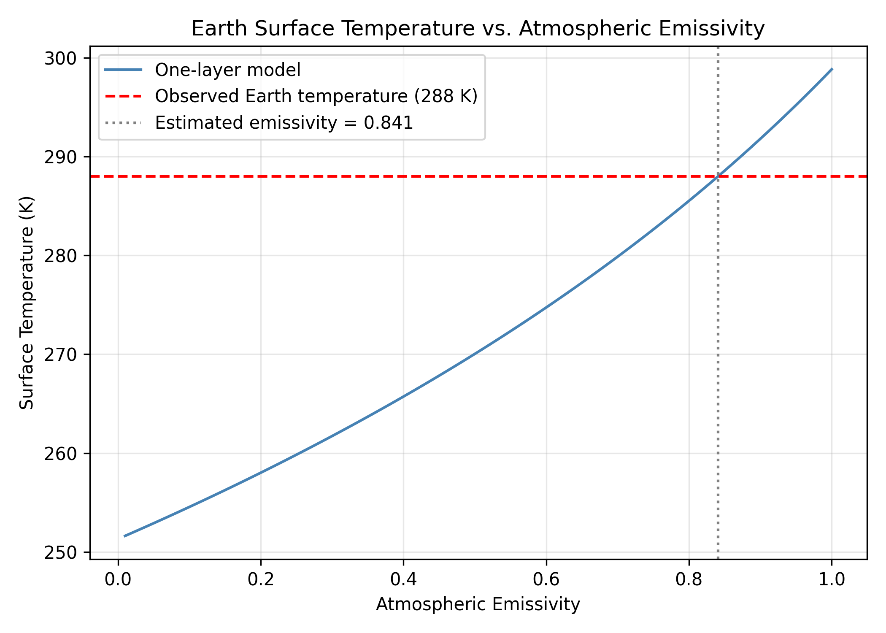
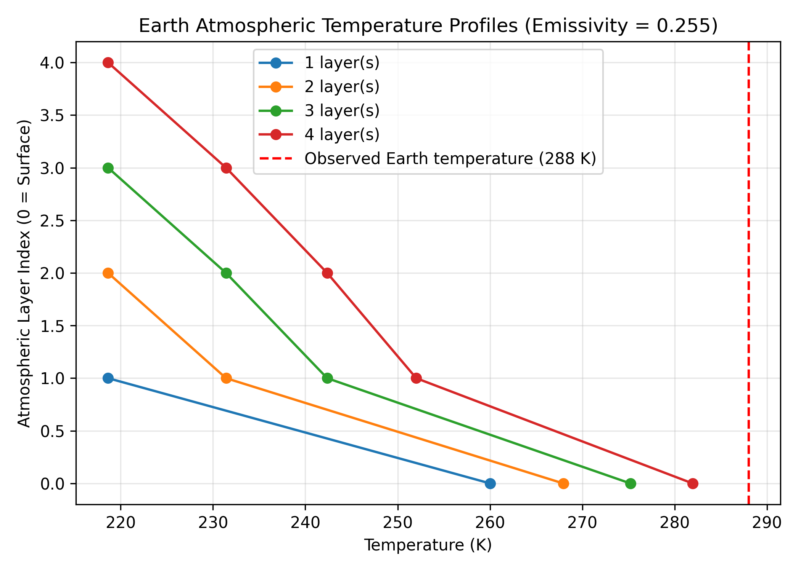
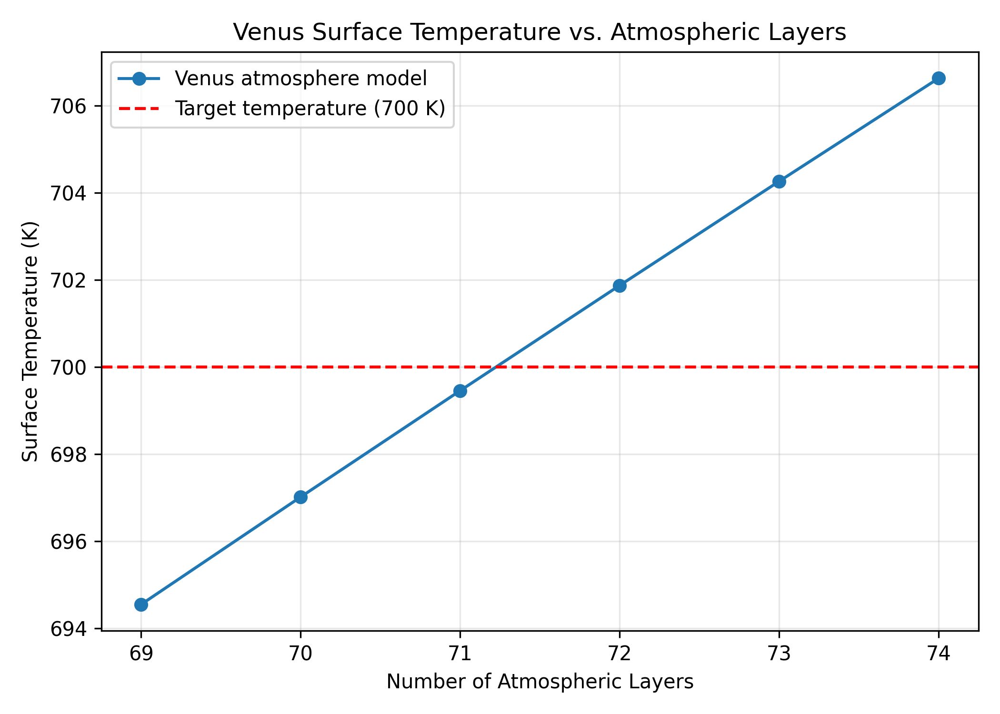
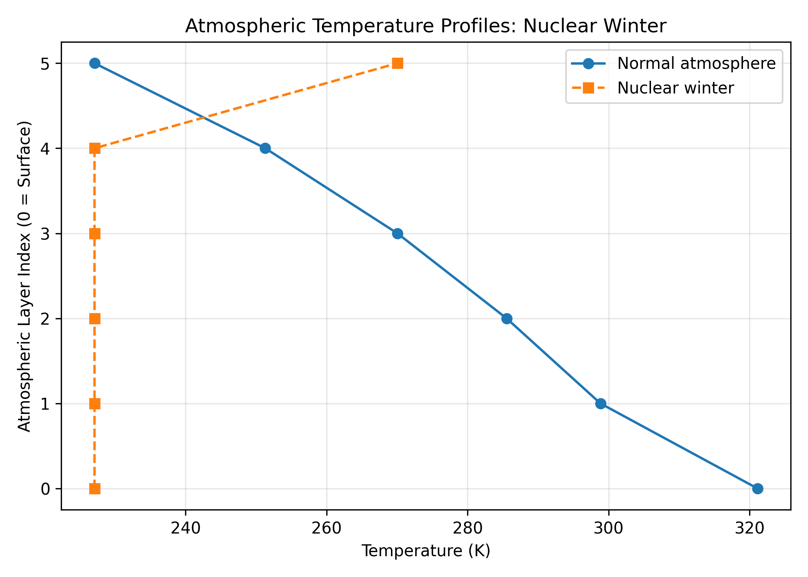

# Lab 03: N-Layer Atmospheric Energy Balance Model

## Overview

This lab uses an N-layer atmospheric energy balance model to investigate how atmospheric emissivity and the number of layers affect planetary surface temperatures. The model is implemented in Python and uses a system of linear equations to calculate equilibrium temperatures.

## Tasks

- **Task 1:** Derive the energy balance equations for an N-layer atmosphere and express them in matrix form.
- **Task 2:** Implement the model using NumPy and validate it with a one-layer blackbody atmosphere.
- **Task 3:** Investigate how atmospheric emissivity and the number of atmospheric layers affect Earth's surface temperature.
- **Task 4:** Estimate the number of atmospheric layers needed to reproduce Venus's surface temperature.
- **Task 5:** Compare atmospheric temperature profiles under normal conditions and a simplified nuclear winter scenario.

## Methods

The model assumes a blackbody surface and atmospheric layers with uniform emissivity. Under normal conditions, the atmospheric layers are transparent to incoming solar radiation and absorb and emit longwave radiation.

The energy balance equations are expressed as:

Ax=b

The linear system is solved using `numpy.linalg.solve()`, and the resulting radiative fluxes are converted to temperatures using the Stefan–Boltzmann law.

## Results

| Experiment | Result |
|---|---|
| One-layer validation | Surface: 298.84 K; Atmosphere: 251.30 K |
| Earth emissivity experiment | Emissivity of 0.841 produces a surface temperature of 288 K |
| Earth atmospheric layers | Four layers produce 281.94 K with emissivity of 0.255 |
| Venus | 71 layers produce 699.45 K, assuming albedo = 0.71 and emissivity = 1 |
| Nuclear winter | Surface temperature decreases from 321.13 K to 227.07 K |

The model results are based on simplified radiative assumptions and do not include processes such as convection or atmospheric circulation.

## Figures

### Earth Surface Temperature vs. Emissivity


### Earth Atmospheric Temperature Profiles


### Venus Surface Temperature


### Nuclear Winter


## Files

- `Lab 03_yinjiao.py` — Python implementation of the atmospheric energy balance model and experiments.
- `figures/` — Figures generated for Tasks 3–5.

## Requirements

- Python 3
- NumPy
- Matplotlib

## Running the Code

From the repository root:

```bash
python "Lab03/Lab 03_yinjiao.py"
```

The script prints the model results and saves the generated figures in `Lab03/figures/`.
